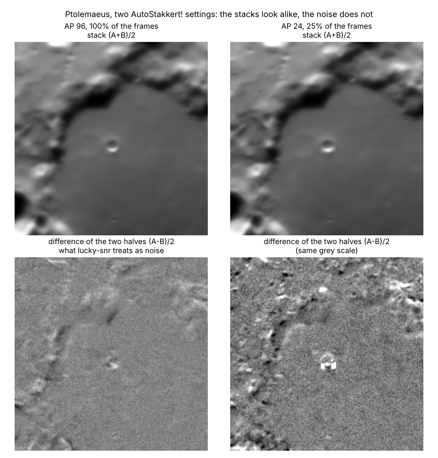
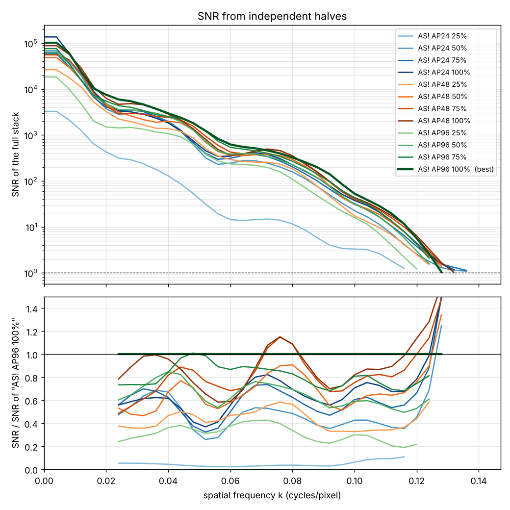

# lucky-snr

**Which stacking settings are really best?** `lucky-snr` answers this with a number instead of a visual impression.

It splits your video into two independent halves; you stack both halves with the settings you want to compare
(AutoStakkert! or any other stacker); `lucky-snr` then measures, for every setting, how much real signal the stack
contains at each spatial frequency, and tells you which setting is best and which ones are statistically equivalent.

No reference image is needed, and the measure does not depend on how the stacks are sharpened afterwards.

*Two AutoStakkert! settings on the same video of Ptolemaeus. The stacks look alike, but the difference of the two
independent halves shows 2.3 times more noise, and AP artefacts on the small crater, for the second one:
`lucky-snr` turns this into a number for every spatial frequency.*

## Idea

The stacks of the two halves contain the same object but independent noise. For each ring of spatial frequency k
(B registered on A), the signal-to-noise ratio of the **full** stack (A + B)/2 is

    SNR(k) = Re<F_A F_B*> / ( <|F_A - F_B|^2> / 4 )

where F_A, F_B are the Fourier transforms of the two stacks. From it:

* **cutoff k_c**: the first frequency where SNR < 1. Beyond it there is no recoverable detail: linear sharpening
  only amplifies noise;
* **information**: the sum over Fourier modes of log2(1 + SNR), in bits: a single number to rank the settings.

Why this is the right yardstick: a linear sharpening filter (Wiener, unsharp mask, deconvolution) multiplies signal
and noise by the same factor, so it does not change SNR(k). After an optimal deconvolution the error left at each
frequency is P(k) / (1 + SNR(k)): the setting with the higher SNR gives the better image *after* processing, however
soft the raw stack looks.

## Install

    pip install .

Python ≥ 3.9; installs numpy, scipy, tifffile, matplotlib and pillow. For development: `pip install -e .[test]`
and `pytest tests`.

## Use

### 1. Split the video

    lucky-snr split video.ser

* crops a 512 × 512 square that follows the drift (`--crop 0` for the full frame, `--center Y X` to choose the place);
  the crop keeps the raw Bayer pattern, so colour videos stay colour videos;
* groups consecutive frames in blocks longer than the seeing correlation time (estimated automatically,
  `--block N` to force it) and assigns the blocks to the halves in Thue–Morse order (A B B A B A A B …), which
  cancels slow drifts between the halves (moving shadows, changing seeing, focus);
* gives the two halves the same number of frames (some stackers require it);
* `--frames 0-775,1270-2900` excludes frames you know are bad (clouds, a touched telescope…).

Output: `video_crop512_A.ser`, `video_crop512_B.ser` and `video_crop512_split.csv` (which frame went where).

### 2. Stack both halves with the settings to compare

With **AutoStakkert!**:

1. Open one half (`_A.ser`), choose an AP size, fill up to **four frame percentages** (e.g. 25, 50, 75, 100):
   AS! makes all of them in one run.
2. **Do not** sharpen or normalise the stacks (*Sharpened* and *Normalize* off); save as TIF or FITS.
3. Close the file, open the other half (`_B.ser`) and repeat with **exactly the same settings**.
4. Repeat for every AP size, always reopening the files.

Check the stacks before comparing: A and B must show the same field, with the same size, no doubled features and no
black borders. With *Surface* stabilization, place the anchor on a contrasted feature (a crater rim), not on a flat
area: on a featureless floor the global alignment can lose track for part of the frames. `compare` warns when a
half-stack looks broken (structure in A and B that does not match); dark featureless areas, such as the night side
beyond the terminator or the sky beyond the limb, are not mistaken for broken stacks.

Each half must be stacked on its own: if AS! reuses the reference frame or the AP grid of one half for the other,
the halves are no longer independent and their SNR is grossly inflated (`compare` warns when this happens).
AS! writes a session file (`.as3`) next to each stack: `lucky-snr` reads the settings from it and pairs A with B by
itself.

**Any other stacker** (AstroSurface, PSS, Registax, your own…): save the two stacks of each setting with names that
differ only by `_A` / `_B` (most stackers keep the video name, so this is usually automatic), or put each setting in
its own sub-folder (the sub-folder name becomes the label), or give the pairs explicitly:

    lucky-snr compare --pair "PSS 50%" pss_A.tif pss_B.tif --pair "Registax" rx_A.tif rx_B.tif

### 3. Compare

    lucky-snr compare folder_with_the_stacks

Output: a table (`lucky_snr.txt`, `.csv`) with SNR(k), cutoff and information for each setting; the best one and the
settings statistically equivalent to it (with an uncertainty from four sub-squares); a plot (`lucky_snr.png`); and
plain-language advice:

* the finest detail supported by the data (period 1/k_c in pixels);
* whether the image is **undersampled** (k_c close to 0.5 cycles/px: a Barlow or drizzle would help) or
  **oversampled** (k_c well below 0.5: a shorter focal length or 2 × 2 binning gives more signal for free);
* with `--pixel 2.9 --focal 3000 --aperture 150 --wavelength 650` (µm, mm, mm, nm): the detail in arcsec and how
  close the stack gets to the diffraction limit.

## Example

Crater Ptolemaeus, Celestron NexStar 6SE (150 mm, f/10) with an SVBONY SV705C camera and an IR-pass filter:
2884 frames, split into two halves of 1440 frames (512 × 512 crop), each stacked with AutoStakkert! 4.0.11 with
AP sizes 24, 48, 96 and 25, 50, 75, 100 % of the frames.

    lucky-snr compare stacks/ --pixel 2.9 --focal 1500 --aperture 150 --wavelength 750

    k (cycles/px)          0.04     0.08     0.12   cutoff   info(kbit)
    AS! AP24 25%          128.4     11.6      0.0    0.120       11.3
    AS! AP24 100%        1828.6    224.5      4.4    0.136       24.0
    AS! AP48 75%         2422.7    352.2      5.7    0.132       24.8
    AS! AP48 100%        2837.9    351.1      6.4    0.136       25.4
    AS! AP96 25%         1073.4    109.2      1.2    0.124       19.3
    AS! AP96 100%        2962.0    323.0      5.7    0.132       25.6
    (excerpt)

    best (most information): AS! AP96 100%   cutoff 0.132 cycles/px
    equivalent within the uncertainty: AS! AP24 100%, AS! AP48 75%, AS! AP48 100%

What it says for this video: with steady seeing, more frames win (100 % or 75 %), and the AP size matters less than
the frame percentage; small APs with few frames (AP 24, 25 %) are clearly worse. The cutoff, about 0.13 cycles/px
(a period of 7.6 px, 3″), is well below the sampling limit: the image is oversampled for this night, and a shorter
focal length or 2 × 2 binning would have given more signal per pixel with no loss of detail.

These conclusions belong to this video, not to AutoStakkert! in general: the best AP size and frame percentage
depend on the seeing, the target, the sampling and the length of the video. A night of worse seeing can favour
fewer frames or other AP sizes. Split and compare again for each session, or at least for each change of
equipment or target type.

## Limitations

* The SNR measures **noise**, not errors common to both halves: a bias shared by A and B (a fixed sensor pattern,
  a wrong reference shared by the two stacks, the same registration artefact) counts as signal. The tool checks the
  most common cases (shared AS! reference, sensor row/column patterns) but cannot detect every common error.
* Stacks must be **linear**: no wavelets, no sharpening, no denoising before the comparison. Non-linear tools
  (wavelets, learned deconvolution) do not preserve SNR(k).
* Each half has half the frames: the SNR reported is that of the full stack, and the ranking does not depend on this.
  On a crop, a stacker ranks the frames on the crop only, so the best frame percentage can differ slightly from the
  full frame; AP size and drizzle transfer well.

## Citation and credits

Emanuele Caglioti. Developed with the help of Claude (Anthropic).
If you use `lucky-snr` in published work, please cite it (see `CITATION.cff`).

## License

MIT, see [LICENSE](LICENSE).
